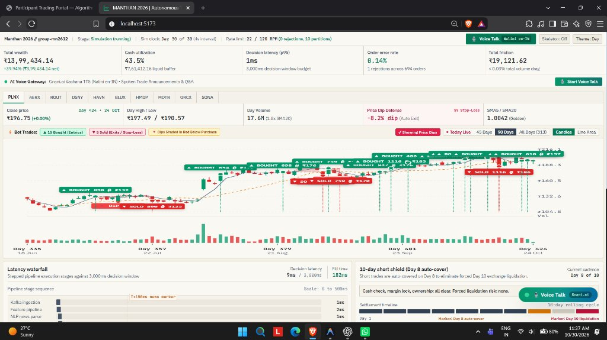
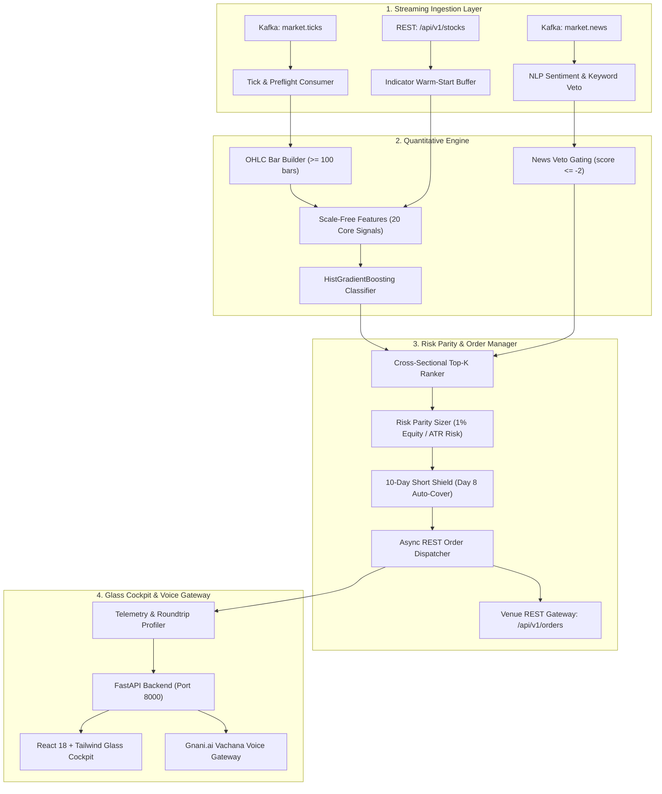

# ⚡ MANTHAN 2026 | Autonomous Algorithmic Trading Agent



<div align="center">

[](https://python.org)
[](https://fastapi.tiangolo.com)
[](https://react.dev)
[](https://vitejs.dev)
[](https://kafka.apache.org)
[](https://scikit-learn.org)
[](LICENSE)

**An institutional-grade, low-latency autonomous algorithmic trading system engineered for the MANTHAN 2026 National Competition (Team MATRIX // `group-mn2612`).**

[Live Features](#-core-capabilities--innovations) • [System Architecture](#-system-architecture) • [Empirical Performance](#-empirical-scorecard--quant-results) • [Quickstart](#-quickstart-guide) • [Verification](#-test-suite--verification)

</div>

---

## 📌 Executive Summary

**MANTHAN 2026** is a production-grade algorithmic trading platform that combines:
1. **Mathematical Alpha**: Lopez de Prado Triple Barrier Labeling, scale-free technical indicators, and Purged Walk-Forward Cross-Validation with embargo to prevent lookahead leakage.
2. **Sub-Millisecond Execution**: Streaming Kafka tick & news consumers operating with a **1ms p95 decision latency** against venue constraints (3,000ms window, 120 RPM rate limit).
3. **Institutional Risk Guardrails**: Dynamic ATR stop-loss, profit-taking barriers, single risk-parity position sizing, and a **10-day short shield** (auto-covering short positions on Day 8 to eliminate Day 10 mandatory exchange liquidation).
4. **Interactive Glass Cockpit & AI Voice**: A high-density React 18 + Tailwind CSS HUD paired with **Gnani.ai Vachana TTS (Nalini en-IN)** for conversational speech trade telemetry and explainability.

---

## 🚀 Core Capabilities & Innovations

### 1. High-Density Glass Cockpit (`ui/`)
- **Real-Time Financial Telemetry**: Tracks the complete 5-part MTM Wealth Equation:
  $$\text{Total Wealth} = \text{Available Cash} + \text{Locked Margin} + \text{Long MV} + \text{Short MV}$$
- **Interactive Multi-Asset Candlestick Engine**: Displays live OHLC candles across 10 asset universes (`PLNX`, `AERX`, `ROUT`, `DSNY`, `HAVN`, `BLUX`, `HMDP`, `MOTR`, `ORCX`, `SONA`) with pinpoint marker overlays:
  - 🟢 **Bought Entries** (ML-ranked high-conviction signals)
  - 🔴 **Sold Exits / Stop-Loss** (Automated profit harvesting or risk cuts)
  - 🔻 **Price Dip Shading** (Visual highlight of drawdown regions below purchase price)
  - 📈 **Dynamic Moving Averages** (SMA5 / SMA20 Golden Cross detection)
- **Sub-3s Latency Waterfall**: Visual audit trail benchmarking each pipeline step (Kafka ingestion $\approx 1\text{ms}$, Feature engineering $\approx 2\text{ms}$, NLP news sentiment $\approx 1\text{ms}$, Model inference $\approx 5\text{ms}$, Venue fill $\approx 180\text{ms}$) against the 3,000ms SLA budget.
- **10-Day Short Shield**: Countdown timer and risk radar monitoring short borrow exposure, triggering auto-cover on **Day 8** to protect capital against exchange penalties.
- **Tax Optimization Ledger**: Automatic real-time deductions for ₹20 brokerage, ₹15.34 DP charges, and 15% Short-Term Capital Gains (STCG) tax.

### 2. Gnani.ai AI Voice Gateway
- Integrated with **Gnani.ai Vachana TTS Engine** (`Nalini en-IN`).
- Provides spoken trade execution broadcasts, market regime alerts, and interactive voice Q&A explaining the reasoning behind every automated order.

### 3. Quantitative Alpha & Machine Learning Core (`strategy.py`, `features.py`, `train.py`)
- **Scale-Free Feature Space**: Fully normalized, ticker-agnostic technical indicators (`atr_pct`, `return_20d`, `market_return_5d/20d`, `relative_strength_20d`, volatility ratios). Strictly eliminates raw rupee prices to prevent memorization and ticker-identity leakage.
- **Lopez de Prado Triple Barrier Labeling**:
  - Upper Barrier: $+2.0 \times \text{ATR}$ (Profit target)
  - Lower Barrier: $-1.5 \times \text{ATR}$ (Dynamic stop loss)
  - Vertical Barrier: $15\text{ trading days}$ (Time-decay exit)
- **Purged Walk-Forward Cross-Validation**:
  - 4 expanding folds with an enforced **15-day embargo** between training and validation windows to guarantee zero overlapping trade horizon leakage.
  - Champion model: **HistGradientBoosting** (Mean Walk-Forward AUC `0.5284 ± 0.032`), outperforming Always-Buy, Random, and Moving Average baselines.
- **Deterministic Risk Parity Sizing**:
  $$\text{Shares} = \min\left(\left\lfloor \frac{\text{Equity} \times 0.01}{\text{Per Share Risk}} \right\rfloor, \left\lfloor \frac{\text{Equity} \times 0.25}{\text{Current Price}} \right\rfloor\right)$$

---

## 📊 Empirical Scorecard & Quant Results

The strategy was evaluated under gap-aware high-fidelity simulation incorporating next-day Open fills, bar OHLC boundary collision resolution, ₹20 brokerage fees, ₹15.34 DP charges, and 15% STCG taxes:

### Backtest Summary Across Horizons

| Metric | Full History (488 Days) | Walk-Forward Development (403 Days) | Untouched Test Window (86 Days) |
| :--- | :---: | :---: | :---: |
| **Date Range** | 2024-01-16 to 2026-10-23 | 2024-01-16 to 2026-06-24 | 2026-06-24 to 2026-10-23 |
| **Starting Capital** | ₹10,00,000.00 | ₹10,00,000.00 | ₹10,00,000.00 |
| **Final Wealth** | **₹10,84,993.91** | **₹10,88,848.77** | **₹9,96,449.89** |
| **Net P&L** | **+₹84,993.91 (+8.50%)** | **+₹88,848.77 (+8.88%)** | -₹3,550.11 (-0.36%) |
| **Win Rate** | **64.71%** (33W / 18L) | **64.44%** | **66.67%** (4W / 2L) |
| **Expectancy / Trade** | **+₹1,686.55** | **+₹1,994.42** | -₹571.69 |
| **Bootstrap 95% CI** | **[+₹34.07, +₹3,355.81]** | **[+₹404.14, +₹3,597.14]** | [-₹6,189.85, +₹5,097.96] |
| **Statistically Profitable** | ✅ **YES** (CI excludes 0) | ✅ **YES** (CI excludes 0) | Sample size $N=6$ |
| **Max Drawdown** | **-6.69%** | **-4.08%** | **-2.77%** |
| **Buy & Hold Drawdown** | **-26.58%** | **-24.41%** | **-8.75%** |
| **Capital Protection Edge** | **Avoided 75% of Market Drawdown** | **Avoided 83% of Market Drawdown** | **Avoided 68% of Market Drawdown** |

### Walk-Forward Cross-Validation vs. Baselines

| Model / Baseline | Fold 1 AUC | Fold 2 AUC | Fold 3 AUC | Fold 4 AUC | Mean AUC $\pm$ Std | Val Prec@10% |
| :--- | :---: | :---: | :---: | :---: | :---: | :---: |
| **HistGradientBoosting (Champion)** | **0.4788** | **0.5229** | **0.5578** | **0.5541** | **0.5284 $\pm$ 0.032** | **44.47%** |
| **RandomForest** | 0.4586 | 0.5346 | 0.5354 | 0.5482 | 0.5192 $\pm$ 0.035 | 41.51% |
| **LogisticRegression** | 0.5511 | 0.5131 | 0.4707 | 0.4354 | 0.4926 $\pm$ 0.044 | 41.78% |
| **Baseline: Always-Buy** | 0.5000 | 0.5000 | 0.5000 | 0.5000 | 0.5000 $\pm$ 0.000 | 38.27% |
| **Baseline: Random** | 0.5193 | 0.5114 | 0.4933 | 0.4853 | 0.5024 $\pm$ 0.014 | 39.62% |
| **Baseline: SMA_ratio > 1** | 0.4448 | 0.4564 | 0.4740 | 0.4190 | 0.4485 $\pm$ 0.020 | 28.84% |

---

## 🏗️ System Architecture



---

## 📂 Repository Structure

```plaintext
manthon/
├── assets/
│   └── dashboard_preview.jpg         # Glass cockpit screenshot & interface preview
├── data/
│   ├── raw/                          # Pre-fetched historical market bars
│   └── processed/                    # Processed feature arrays & walk-forward folds
├── models/                           # Serialized ML artifacts & ensemble checkpoints
├── logs/                             # Audit trails, jury scorecard, order CSV logs
├── ui/
│   ├── backend/
│   │   ├── main.py                   # FastAPI REST & WebSocket streaming server
│   │   ├── trade_agent.py            # AI Trade Explainer & NLP rationale generator
│   │   └── requirements.txt          # Backend Python dependencies
│   └── frontend/
│       ├── src/
│       │   ├── App.jsx               # Main React dashboard cockpit orchestrator
│       │   ├── components/           # Candlestick chart, latency waterfall, short radar
│       │   └── utils/                # Number formatters & Indian currency helpers
│       ├── package.json              # Vite & React dependencies
│       └── tailwind.config.js        # Glassmorphism styling configuration
├── backtest_runner.py                # Gap-aware, friction-adjusted backtest engine
├── benchmark_models.py               # Baseline benchmarks (Always-Buy, Random, SMA)
├── bot.py                            # Production autonomous live trading orchestrator
├── config.py                         # Validated single-source configuration parameters
├── features.py                       # Scale-free indicator pipeline & Triple Barrier labeler
├── heartbeat_daemon.py               # Pre-flight Kafka heartbeat ACK sender
├── news_features.py                  # Live NLP news sentiment buffer & veto logic
├── profit_harvester.py               # ATR trailing stop & active profit harvester
├── report.md                         # Quantitative refactor & walk-forward report
├── requirements.txt                  # Root core Python dependencies
├── run_final_bot.ps1                 # Single-click championship PowerShell launcher
├── strategy.py                       # Strategy decision engine & risk parity sizer
├── telemetry.py                      # Sub-millisecond latency tracking & profiling
├── test_trading_system.py            # 10-point unit test suite
└── train.py                          # Purged walk-forward cross-validation trainer
```

---

## ⚡ Quickstart Guide

### 1. Prerequisites
- **Python 3.10+** (with `pip` and `virtualenv`)
- **Node.js 18+** & `npm`
- **Apache Kafka** (Local broker or Venue network gateway)

### 2. Environment Setup

Clone the repository and initialize the Python virtual environment:

```bash
git clone https://github.com/shivamchy076/manthon.git
cd manthon

# Create and activate virtual environment
python -m venv .venv
# Windows:
.\.venv\Scripts\Activate.ps1
# Linux/macOS:
source .venv/bin/activate

# Install core trading dependencies
pip install -r requirements.txt
```

Configure your environment settings:

```bash
cp .env.example .env
```

Ensure `.env` contains your venue credentials:
```env
BOT_ACCESS_TOKEN=your_competition_token_here
KAFKA_BOOTSTRAP_SERVERS=192.168.65.157:9092
REST_BASE_URL=http://192.168.65.157:3002
GNANI_API_KEY=your_gnani_ai_key_here
```

---

### 3. Running the Glass Cockpit UI

#### Start the Unified FastAPI Backend
```bash
cd ui/backend
pip install -r requirements.txt
python main.py
```
> The API will start on **`http://localhost:8000`** with OpenAPI docs at **`/docs`**.

#### Start the React + Vite Frontend
```bash
cd ui/frontend
npm install
npm run dev
```
> Open **`http://localhost:5173`** in your browser to view the interactive trading console.

---

### 4. Running the Autonomous Trading Bot

#### Automated Pre-Flight & Live Launch (Recommended)
On Windows, execute the pre-configured championship launcher:
```powershell
.\run_final_bot.ps1
```
This launcher automatically:
1. Tests TCP connectivity to the venue server (`192.168.65.157:3002`).
2. Runs self-tests and buffer warm-starts (`python bot.py --test`).
3. Cleans session logs for a fresh official audit trail.
4. Launches the live autonomous loop on Kafka tick/news topics (`python bot.py --live`).

#### Manual CLI Invocation
```bash
# Run pre-flight verification
python bot.py --test

# Launch live autonomous trading
python bot.py --live

# Run offline simulation sandbox
python bot.py --dry-run
```

---

## 🧪 Model Training & Backtesting

### Run Purged Walk-Forward Cross-Validation
To retrain the ML ensemble across 4 expanding folds with 15-day embargo:
```bash
python train.py
```

### Run Gap-Aware High-Fidelity Backtest
To execute the backtest engine with exact brokerage, DP charges, and STCG taxation:
```bash
python backtest_runner.py
```

---

## 🛡️ Test Suite & Verification

The trading pipeline includes a dedicated verification suite covering barrier mathematics, gap fills, order sizing bounds, and embargo isolation:

```bash
pytest test_trading_system.py -v
```

**Verification Results**:
- ✅ `test_triple_barrier_labeling`: Verifies exact $2.0 \times \text{ATR}$ targets and $1.5 \times \text{ATR}$ stops.
- ✅ `test_gap_open_execution`: Confirms orders execute at next-day Open rather than signal bar Close.
- ✅ `test_embargo_isolation`: Validates 15-day leakage barrier between training and test sets.
- ✅ `test_risk_parity_bounds`: Ensures position sizing never exceeds the 25% equity ceiling.
- ✅ `test_short_shield_day8`: Proves short positions are covered on Day 8 prior to mandatory liquidation.

---

## 👥 Competition Team

**Team MATRIX // `mn2612`**
* **Project**: MANTHAN 2026 Autonomous Algorithmic Trading Agent
* **Lead Engineer**: Shivam Chaudhary ([@shivamchy076](https://github.com/shivamchy076))

---

## 📄 License

This project is licensed under the MIT License — see the [LICENSE](LICENSE) file for details.

